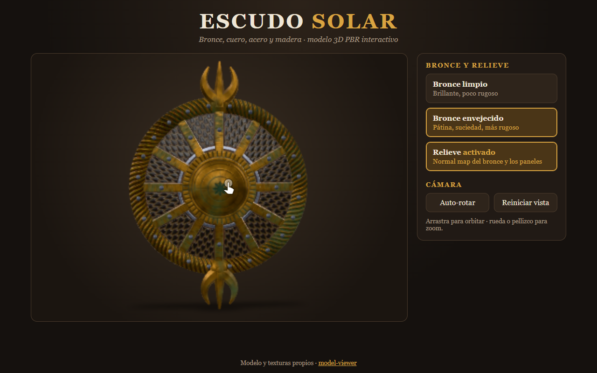
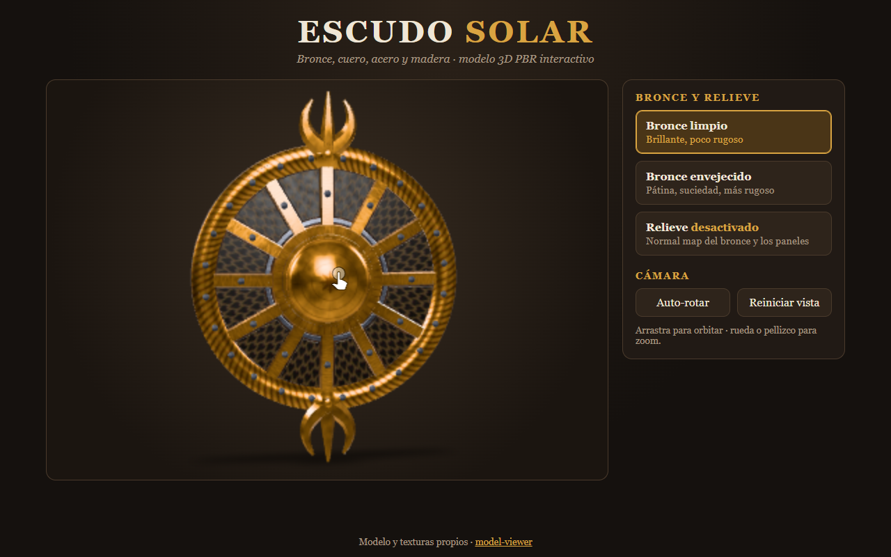

# Escudo Solar 3D

Escudo circular de bronce con paneles oscuros de escamas, radios metálicos, medallón solar y dos adornos curvos
simétricos, modelado y texturizado desde cero (versión 2) y mostrado con [`<model-viewer>`](https://modelviewer.dev/) 4.4.0.
Inspirado visualmente en una imagen de referencia; todo el modelado y las texturas son propios y procedurales.




- **Sitio publicado:** https://dgael-22.github.io/escudo/
- **Repositorio:** https://github.com/dgael-22/escudo
- **Modelo:** [`assets/shield.glb`](assets/shield.glb) (≈ 0,9 MB)

## Modelo

Silueta circular (Ø 1 m) con ligera curvatura de cúpula. La profundidad se limita a lo esencial: reborde trenzado,
medallón solar escalonado, 12 radios arqueados, adornos superior/inferior (tridente en media luna con bulbo) y remaches.
Las escamas de los paneles **no están modeladas**: son normal map + roughness + base color sobre 12 paneles planos.

| Pieza | Material | Triángulos |
|---|---|---|
| Reborde, 12 radios, medallón solar, adornos | `Bronce` | 3 384 |
| 24 remaches de reborde, 12 de radios, anillo fino | `Acero` | 1 152 |
| Disco trasero | `Madera` | 1 440 |
| 12 paneles frontales | `Cuero` | 768 |
| **Total** | 4 mallas, 4 materiales | **≈ 6 750** |

## Materiales y texturas (PBR metal/rough, embebidas en el GLB como JPEG q85)

| Material | Uso | Resolución | Mapas |
|---|---|---|---|
| `Bronce` (envejecido por defecto) | borde, radios, medallón, adornos | 1024² (atlas) | Base Color, ORM (G rough, B metal), Normal |
| `Acero` oscuro | remaches y anillo | 512² | Base Color, ORM, Normal |
| `Madera` oscura | parte trasera | 1024² | Base Color, ORM, Normal |
| `Cuero` oscuro | paneles frontales (escamas) | 512² | Base Color, ORM, Normal |

Fuera del GLB: `assets/textures/bronce_limpio_*.jpg` (1024², variante de bronce limpio; se carga al pulsar el botón 1).

**UVs:** bronce en un atlas sin solapes (franja superior = reborde con trenza repetible, columna = radios, cuadrante = medallón
como calcomanía planar, derecha = adornos); los 12 radios comparten región UV a propósito (patrón idéntico) y los paneles de
cuero usan un patrón repetible. Madera: proyección planar del disco. Acero: Smart UV Project + empaquetado.

## Controles

Los tres botones principales cambian realmente los materiales del GLB vía la API de scene-graph de model-viewer:

1. **Bronce limpio** – sustituye base color, metálico/rugosidad y normal del material `Bronce` por la variante brillante y poco rugosa.
2. **Bronce envejecido** – restaura la variante con pátina, suciedad y mayor rugosidad (estado inicial).
3. **Relieve activado/desactivado** – quita o restaura el normal map del `Bronce` y de las escamas del `Cuero`.

Además: órbita, zoom, **Auto-rotar** y **Reiniciar vista**. Se muestra un mensaje si el modelo o las texturas no cargan.

## Herramientas

Blender 5.2 (modelado por script con bmesh, UVs, nodos Principled BSDF, export glTF), Python + numpy + Pillow (texturas
procedurales), model-viewer 4.4.0, HTML/CSS/JS sin build, Edge headless para las pruebas y capturas.

## Ejecutar en local

```bash
python -m http.server 8123   # abrir http://localhost:8123 (debe servirse por HTTP)
```

Regenerar el modelo: `python fuente-3d/make_textures.py` y luego `blender -b -P fuente-3d/build_shield.py`.

## Qué sustituye a la versión anterior

- **Reemplazados:** `assets/shield.glb` (escudo heráldico → escudo circular), `index.html`, `css/styles.css` (añade un estilo),
  `js/app.js` (nuevos botones y materiales) y este `README.md`.
- **Eliminados:** carpeta `tools/` (generador de texturas y script de Blender antiguos), texturas `madera/acero/bronce_desgastado_*.png`
  y las capturas anteriores.
- **Nuevos:** `fuente-3d/` (`make_textures.py`, `build_shield.py`, `shots.mjs`, `escudo.blend`, `tex/` con los mapas originales PNG),
  `assets/textures/bronce_limpio_*.jpg` y capturas nuevas en `screenshots/`.
